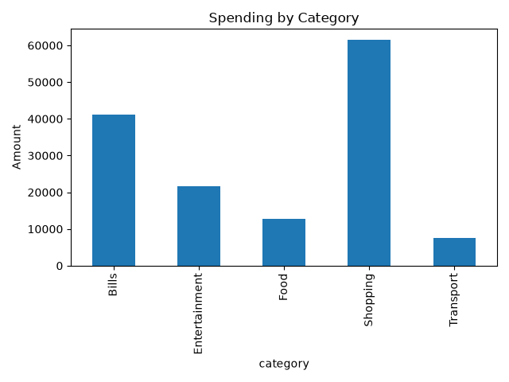
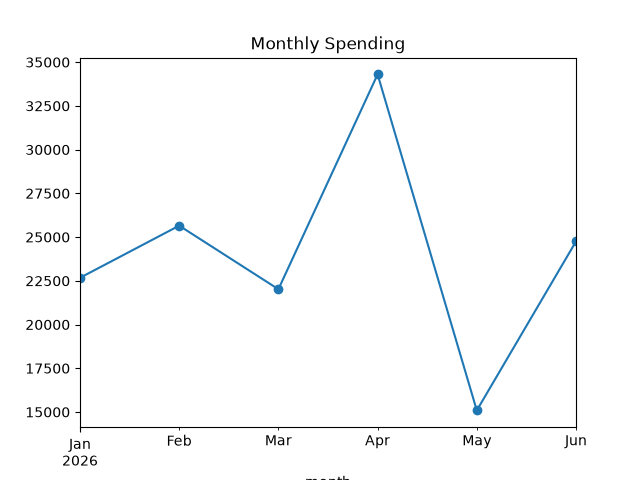

# Personal Expense Analysis

## Objective
Find out where my money goes each month and which habits cost the most.

## Data
240 transactions from 1 Jan 2026 to 28 Jun 2026 across 5 categories
(Food, Transport, Shopping, Bills, Entertainment).
The data is sample data generated with Python.

## Tools
Python, pandas, matplotlib

## Key Findings
1. Total spending was 144,487, with an average of 602 per transaction.
2. Shopping is the biggest category at 42.5% of all spending.
3. Transport is the smallest at only 5.2%.
4. Spending was highest in April (34,300) and lowest in May (15,092).

## Charts

## Recommendations
- Set a monthly limit for Shopping, since it takes the largest share.
- Look into what caused the spike in April and the drop in May.